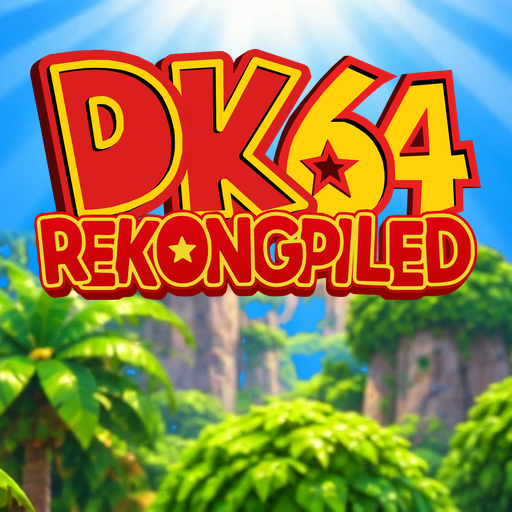

# DK64 Rekongpiled for the PS5

<p align="center"></p>

A port of [DK64: Recompiled](https://github.com/Rainchus/Donkey-Kong-64-Recompiled) (v1.0.3) to the PS5 as
native homebrew: 4K widescreen, 60 fps, the HD texture pack, mods, and a menu made for the DualSense. It runs
as an installed title (`PPSA64064`) and renders with RT64 through Vulkan on
[Mihawk's RADV port](https://github.com/mihawk-99/PS5_Vulkan).

Unofficial, and not affiliated with or endorsed by Nintendo or Sony.

**This repository and its releases contain no game assets. You need your own Donkey Kong 64 (USA) ROM.**

## What you need

- A PS5 that runs homebrew (an enabler such as etaHEN) with **ShadowMountPlus**, which puts homebrew on the home
  screen. Tested on firmware 13.60.
- **Your own Donkey Kong 64 ROM**, the USA version 1.0: SHA-1 `cf806ff2603640a748fca5026ded28802f1f4a50` as `.z64`
  (`.n64` and `.v64` dumps are converted). No other version or language works.

## Installing

1. Download `PPSA64064.zip` from the [latest release](../../releases/latest) and extract it into a folder
   ShadowMountPlus scans: `/data/homebrew/` on the console's storage, or `homebrew/` on a USB drive or M.2 storage.
2. Put your ROM in the `PPSA64064` folder, next to `eboot.bin`. Any file name works.
3. Let ShadowMountPlus register the title, then start **DK64 Rekongpiled** from the home screen.

On the first start the game checks the ROM and keeps its own copy (`DK64.z64`); after that the file you added can
be removed. Without a usable ROM the game says where to put it, and why a ROM file it found was refused.

**Press the touchpad** to open the game's menu: settings, controls, sound and mods.

**Updating**: copy the new `PPSA64064` folder over the old one. Your save (`saves/`), settings (the `.json`
files), mod settings (`mod_config/`), added mods and texture packs (`mods/`) and the ROM copy are kept: a release
contains none of them.

## Built-in mods

Two mods come built in and are switched on: turn them off in the menu under **Mods** if you'd rather play
without them.

- **[Tag Anywhere](https://github.com/Killklli/DK64TagAnywhereRecomp)** 1.0.3: switch Kong from (almost)
  anywhere with **D-pad left and right**, without going back to a Tag Barrel. Only the Kongs you have unlocked.
- **[Tag Anywhere Sparkles](https://github.com/theballaam96/RecompTAEffect)** 1.0.1: a sparkle and a sound when
  you switch.

## HD textures (recommended)

For the full HD experience, add Michi's HD texture pack (from Gaming Revived's ReVived textures). It isn't
included in the release because it isn't part of this project; get it from its own page:

1. Download `HD_Textures.rtz` from **[DK64-Recomp-HD-Textures](https://github.com/Michieru/DK64-Recomp-HD-Textures/releases/tag/Textures)**.
2. Copy it into the `mods` folder inside `PPSA64064` (the game makes the folder on its first start).
3. Start the game: the pack is switched on, and shows under **Mods**, where it can be turned off and on at once.

It streams its textures as they're needed and holds 60 fps on the console.

## Other mods

Code mods (`.nrm`) and texture packs (`.rtz`) made for DK64: Recompiled load from `mods/` in the title folder.
Texture packs switch on and off at once. A code mod can't change while the game runs: its switch asks to close
the game, and the change applies when it is started again. Mods that need native libraries (such as those built
on RecompExternalPython_API) can't load on the PS5.

## What's different on the PS5

- The game starts straight away, with no launcher: the ROM comes from the title folder.
- 4K output, the game's frames interpolated to 60 fps (Framerate **Original** keeps 30).
- A menu for the console: PlayStation button prompts, and no options that only make sense on a PC (window,
  mouse, keyboard, gyro, installing mods from the internet). Multiplayer stays locked: upstream lists it as
  unfinished.
- Follow Cam is the default camera.
- A **Performance Overlay** option (Graphics tab): frame rate, a frame-time graph and memory.
- `dk64.log` in the title folder records the start-up, errors and crash reports, with the previous session's
  log kept as `dk64.prev.log`. Please include them when reporting a problem.

## Known issues

- The DualSense is listed as two controllers in the controls menu. It doesn't affect play.

## Building

On Linux (here: a dedicated Ubuntu 26.04 WSL distro, no Docker). Building needs the ROM too, as the game's
code is generated from it:

```sh
setup/wsl-packages.sh                          # as root, once: compilers and build tools
setup/fetch-sources.sh                         # once: all sources at pinned commits
tools/setup-source.sh "Donkey Kong 64.z64"     # apply patches/, generate the game code from the ROM
./build.sh radv                                # once: RADV, the payload SDK fork, the title converter
./build.sh configure
./build.sh
tools/package.sh                               # dist/PPSA64064, without a ROM
```

`build.sh` runs everything through `tools/run.sh` directly, not in a container. Never publish a build together
with a ROM, or with anything else from the game.

### What the port changes

| File | Change |
| --- | --- |
| `patches/dk64.patch` | DK64 Recompiled's own tree: no launcher (ROM from the title folder; the launcher is only the ROM screen, over the home screen picture), a 3840x2160 window without SDL Vulkan, PS5 start-up and log, no vcpkg, PS5 platform code and libraries in CMake, no gyro or mouse inversion options, no Technical tab (its only option unlocks upstream's unfinished multiplayer), Follow Cam by default |
| `patches/lib__N64ModernRuntime.patch` | N64 memory from a kernel reservation backed by direct memory, thread names, an error exit the console allows, built-in mods, code mod switches that apply on the next start |
| `patches/lib__rt64.patch` | Host-built `file_to_c`, a file dialog stub, PS5 threads and window, the performance overlay (`src/gui/rt64_performance_overlay.*`: an ImGui info box and frame-time graph after PCSX2's, plus `[perf]` lines in the log every 10 seconds), the start-up splash kept up until the first frame |
| `patches/lib__rt64__src__contrib__plume.patch` | Presenting through `VK_KHR_display` |
| `patches/lib__RecompFrontend.patch` | Title folder paths, touchpad opens the menu, 60 Hz display, the Performance Overlay option (Graphics tab), a menu for the console: PlayStation button glyphs, Framerate as Original (30) or 60, and no options for a window, downsampling, mouse, gyro, background input or keyboard, or for installing mods from the menu, and no Find Mods tab; UI image loads in the log |
| `ps5/` | Start-up, log and crash reports, relative paths, libc shims (including curl's and OpenSSL's), title linking |
| `mods/` | The built-in mods, embedded at configure time |

## Licences and credits

This repository's own files are licensed under GPL-3.0-or-later ([LICENSE](LICENSE)). A built title links
GPL-3.0 code (DK64: Recompiled, N64ModernRuntime, RecompFrontend, Mihawk's PS5 layer), so the title is a
GPL-3.0 combined work.

- **[DK64: Recompiled](https://github.com/Rainchus/Donkey-Kong-64-Recompiled)** (DK64 Rekongpiled) by Rainchus,
  Ballaam, KillKlli, Green Bean, UmedMuzl and contributors: GPL-3.0. Its logo and launcher artwork are used for
  the splash, the icon and the ROM screen.
- **[N64Recomp](https://github.com/N64Recomp/N64Recomp)** (MIT) and
  **[N64ModernRuntime](https://github.com/N64Recomp/N64ModernRuntime)** (GPL-3.0) by Mr-Wiseguy and contributors
- **[RT64](https://github.com/rt64/rt64)** by Dario and contributors: MIT
- **[RecompFrontend](https://github.com/N64Recomp/RecompFrontend)** by the N64Recomp contributors: GPL-3.0
- **[Donkey Kong 64 decompilation](https://gitlab.com/dk64_decomp/dk64)** headers and functions: CC0
- **[PS5 Vulkan (RADV) port](https://github.com/mihawk-99/PS5_Vulkan)** and its payload SDK fork by Mihawk:
  GPL-3.0-or-later, on the [ps5-payload-dev](https://github.com/ps5-payload-dev) SDK and Mesa (MIT)
- **[Wave Race 64 PS5 port](https://github.com/Marice/wave-race-64-ps5)** by Marice: GPL-3.0-or-later. This
  port's PS5 layer and library patches started from it.
- **PacBrew ports** (SDL2, FreeType and their libraries) by the ps5-payload-dev contributors, under their own
  permissive licences
- **RmlUi**, **lunasvg**, **Dear ImGui**: MIT. **PromptFont**, **Inter**, **Noto Emoji**: SIL Open Font
  Licence. **Suplexmentary Comic NC** by Jayvee D. Enaguas, as shipped by DK64: Recompiled.
- **[Tag Anywhere](https://github.com/Killklli/DK64TagAnywhereRecomp)** and
  **[Tag Anywhere Sparkles](https://github.com/theballaam96/RecompTAEffect)**: CC0
- **[HD texture pack](https://github.com/Michieru/DK64-Recomp-HD-Textures)** (not included) by Michi, from
  Gaming Revived's ReVived textures, thanks to rocketboy95, RainbowSpectrum and Granvillimus

Donkey Kong 64 is © Nintendo. "Donkey Kong" is a trademark of Nintendo; "PlayStation" and "PS5" are trademarks
of Sony Interactive Entertainment. This project is not affiliated with or endorsed by either.
